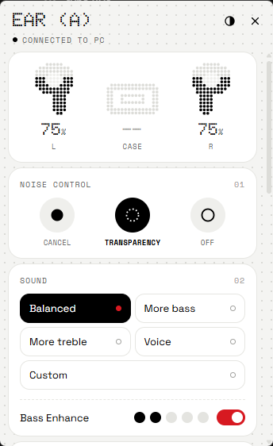
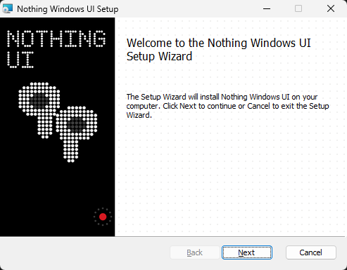

# Nothing Windows UI

An **unofficial**, free system tray app to control Nothing earbuds on Windows: battery, noise control, EQ, gestures and more. Think of it as the Nothing X phone app, on your PC.

> **100% free.** No ads, no account, nothing to buy.
> **Collects no personal data.** The app contains no network code and sends nothing anywhere. See [PRIVACY.md](PRIVACY.md).
> **Not affiliated with Nothing.** "Nothing", "CMF" and their products and trademarks belong to Nothing Technology Limited. See [Legal](#legal).

<p>
  
  
</p>

## Download

Get the installer from the [latest release](https://github.com/noiab3d/nothing-windows-ui/releases/latest):

| Your PC | File |
|---|---|
| Intel or AMD | `Nothing.Windows.UI_x.y.z_x64_en-US.msi` |
| Snapdragon (ARM) | `Nothing.Windows.UI_x.y.z_arm64_en-US.msi` |

To check which you have: Settings → System → About → "System type".

Windows SmartScreen will warn you, because the installer isn't code-signed: choose **More info → Run anyway**. Then pair your earbuds in the Windows Bluetooth settings; the app finds them on its own.

**To update**, open the new `.msi` over the installed version. Your settings are kept.

## Features

- **Battery** of each earbud and the case, also on the tray icon as dot-matrix digits
- **Noise control**: cancellation levels, transparency, off
- **Sound**: EQ presets, custom EQ, Bass Enhance
- **Gestures** for each earbud
- **Dual connection**: see and disconnect the devices your earbuds are connected to
- **Audio quality**: AAC / LDAC where supported
- **Disconnect / connect** the earbuds from the PC, so they're free to connect to your phone
- **In-ear detection**, **low latency** (re-applied each time the earbuds connect), **find my earbuds**, **ear tip fit test**
- Detects the Bluetooth state and whether your earbuds are connected
- Light and OLED themes; English, Portuguese, Spanish, French, German and Italian
- Starts with Windows, stays in the tray, notifies on connection and low battery

## Supported models

The app asks the earbuds which model they are, then shows only the controls that model has.

| Status | Models |
|---|---|
| **Tested** | Nothing Ear (a) |
| **Not tested** (shows a warning in the app) | Nothing Ear, Ear (1), Ear (2), Ear (3), Ear (3a), Ear (open), Ear (stick), Headphone (1), Headphone (1) Pro, Headphone (a); CMF Buds, Buds 2, Buds 2a, Buds 2 Plus, Buds Pro, Buds Pro 2, Clip Pro, Headphone Pro, Neckband Pro |

Have one of the untested models? Please [report how it went](https://github.com/noiab3d/nothing-windows-ui/issues/new?template=model_report.md): that's the most useful contribution right now.

See also the [known issues](KNOWN_ISSUES.md).

## Build it yourself

Needs [Rust](https://rustup.rs), Node.js, and the Visual Studio C++ build tools (plus the ARM64 component for ARM builds):

```bash
cd rust
npm install
npm run build:x64
```

Use `npm run build:arm64` for ARM. The `.msi` lands in `rust/src-tauri/target/<target>/release/bundle/msi/`.

`tools/make_models.py` regenerates `models.json`, and `rust/make_installer_art.py` redraws the installer images.

## How it works

The app talks to the earbuds over the same Bluetooth RFCOMM protocol the Nothing X app uses. It identifies the model through the Fast Pair service, and uses a Windows Bluetooth control to disconnect them.

The protocol knowledge and the per-model data come from the community project [ear-web](https://github.com/radiance-project/ear-web), without which this wouldn't exist. See [NOTICE.md](NOTICE.md).

## Legal

This is an independent, non-commercial community project. It is **not affiliated with, endorsed by or sponsored by Nothing Technology Limited**.

"Nothing", "CMF" and all related names, logos, products and trademarks belong to Nothing Technology Limited. The author claims no ownership of any of them and makes no money from this project. The dot-matrix artwork in this app was drawn for it and uses no Nothing logos or images. If Nothing Technology would like something changed or removed, please [open an issue](https://github.com/noiab3d/nothing-windows-ui/issues).

The source code is licensed under the [GNU GPL v3](LICENSE), and is provided without warranty. It uses a reverse-engineered protocol, so use it at your own risk.

## Credits

Built by [@noiab3d](https://github.com/noiab3d) with [Claude](https://claude.com/claude-code), Anthropic's AI coding assistant, which wrote most of the code.
